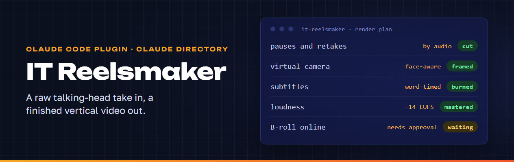
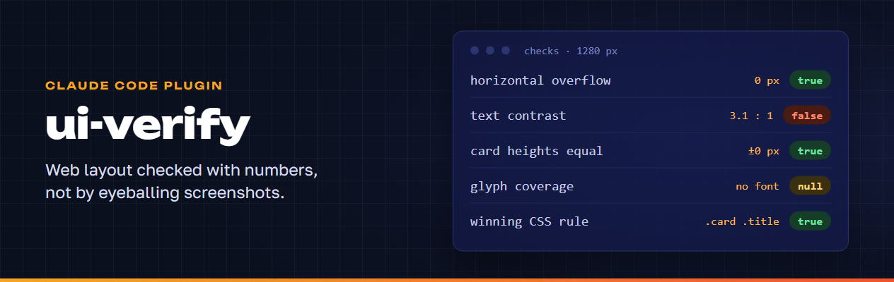
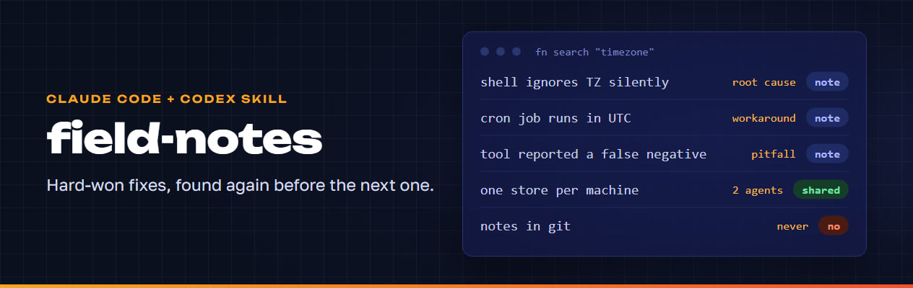
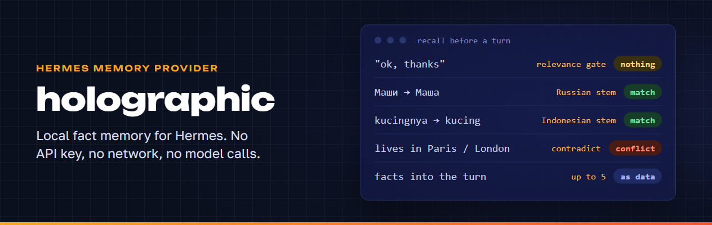

<a href="https://itparty.club/about"></a>

<a href="https://itparty.club/about"></a> <a href="https://t.me/passone"></a> <a href="https://t.me/it_networking_pattaya"></a> <a href="https://www.youtube.com/@IT-party-Pattaya"></a> <a href="https://hr24copilot.online"></a>

I am a digital marketer, not a software engineer. I run a Russian-speaking IT community in Pattaya, help a recruiting agency with its tools, and keep a family AI agent on my own server. Everything below started as a problem in one of those three places, and each repository is the part that someone else can install and use.

## Claude Code and Codex tools

### reels-montage · IT Reelsmaker

<a href="https://github.com/itpartypattaya/reels-montage"></a>

Claude Code plugins that turn a raw talking-head take from a phone into a finished 1080×1920 video for Reels, Shorts or TikTok: pauses and retakes cut by audio, a virtual camera, word-timed subtitles, on-brand graphics in Remotion, face-aware layout and mastering.

**Why it exists.** People who film themselves regularly spend more time editing than recording: experts, recruiters, small brands, SMM specialists. The plugin was built on real videos, so its loudness thresholds, margins and text zones come from practice. Brands are stored as separate profiles, so it is not tied to one company.

**What it is.** A plugin marketplace, `itparty`, with two plugins. `it-reelsmaker` edits locally with ffmpeg, Python, Node.js and Remotion. `it-reelsmaker-online` is an optional add-on for stock footage, CC-licensed memes and paid AI video for B-roll, each used only after you approve the plan. A privacy note lists what data leaves the computer. `it-reelsmaker` passed Anthropic's review and has been in the Claude plugin directory since 2 October 2026.

<a href="https://github.com/itpartypattaya/reels-montage"></a> <a href="https://claude.ai/customize/plugins/id/c1ae3d1a-cbd2-4ee3-be95-a87be163ba1f%40anthropic-plugin-directory"></a>

```
claude plugin marketplace add https://github.com/itpartypattaya/reels-montage.git
claude plugin install it-reelsmaker@itparty
```

### truedev-codex-workflow

<a href="https://github.com/itpartypattaya/truedev-codex-workflow"></a>

A native Codex plugin for gated, file-backed product and engineering work.

**Why it exists.** On long tasks an agent drifts: it touches files nobody asked about, calls the work done without running anything, commits on its own. Here hooks block the next step until a person approves the current one.

**What it is.** A Codex plugin with two skills, Codex hooks and a Python runner. No telemetry; the only network request is an update check, and only with consent. It ships in two editions: one for a GitHub marketplace, one for the ChatGPT Plugins Directory.

<a href="https://github.com/itpartypattaya/truedev-codex-workflow"></a> <a href="https://github.com/itpartypattaya/truedev-codex-workflow/releases/latest"></a>

```
codex plugin marketplace add itpartypattaya/truedev-codex-workflow --ref main
codex plugin add truedev-workflow@truedev-workflow
```

### ui-verify

<a href="https://github.com/itpartypattaya/ui-verify"></a>

A skill for AI coding agents, and a set of plain browser functions for people, that checks web layout with numbers: overflow and its culprit, contrast over real backgrounds, uneven cards, which CSS rule won, theme switching, missing glyphs, covered elements, clipped text.

**Why it exists.** An agent looks at a screenshot, does not see its change and "fixes" CSS that was working. Screenshots lose low-contrast detail and can be taken before the page finishes painting, so a positive result from one is reliable and a negative one is not.

**What it is.** Every check runs inside the page, measures what the browser actually computed and answers in three states: `true`, `false` with the element, numbers and cause, or `null` with the reason it cannot tell. It never fills a gap with a made-up number. A Claude Code plugin in JavaScript; the functions also run on their own in DevTools, Playwright, Puppeteer or Cypress.

<a href="https://github.com/itpartypattaya/ui-verify"></a>

```
claude plugin marketplace add itpartypattaya/ui-verify
claude plugin install ui-verify@ui-verify
```

### field-notes

<a href="https://github.com/itpartypattaya/field-notes"></a>

Engineering field notes shared by Claude Code and Codex CLI: findings that outlive a single project, with root cause, workaround and a tool's pitfalls, searched before the next fix.

**Why it exists.** Both agents use the same `SKILL.md` format, so one skill can serve both, with one store of notes per machine: what one agent records, the other finds. Hard-won diagnosis stops disappearing with the chat it happened in.

**What it is.** A skill with a Python 3.9+ standard-library script and installers for Windows and Linux/macOS that link it into both agents' skill folders. The repository holds only the skill; the notes stay local and never go into git, because they contain real paths, versions and project details. No network. Its bigger sibling for Hermes is hermes-field-notes below.

<a href="https://github.com/itpartypattaya/field-notes"></a> <a href="https://github.com/itpartypattaya/field-notes/releases/latest"></a>

Install: `git clone https://github.com/itpartypattaya/field-notes.git`, then `pwsh -File install.ps1` on Windows or `sh install.sh` elsewhere.

### mafia-review-skill

<a href="https://github.com/itpartypattaya/mafia-review-skill"></a>

A Codex skill that reviews a club game of Mafia from two audio transcripts and the host's score sheet: roles, night events, timeline, key moments and ratings.

**Why it exists.** Our city Mafia league at [mafia.itparty.club](https://mafia.itparty.club) publishes a review of every game. This skill produces the same review on an agent subscription instead of a paid API pipeline, in the exact format the site imports.

**What it is.** A `SKILL.md` method plus two standard-library Python scripts that score the review and validate the bundle before import.

<a href="https://github.com/itpartypattaya/mafia-review-skill"></a>

## Hermes Agent skills and plugins

[Hermes Agent](https://github.com/NousResearch/hermes-agent) by Nous Research is the agent I use every day. Four of the plugins below are listed in the official Hermes Plugin Catalog.

### holographic · memory provider

<a href="https://github.com/itpartypattaya/hermes-plugin-holographic"></a>

The local memory provider that shipped inside Hermes core as `holographic`: a SQLite fact store with full-text search, trust scoring, entity resolution and HRR retrieval. Everything stays on your machine.

**Why it exists.** When the provider was scheduled to leave Hermes core on 15 October 2026, Nous Research handed it off, and since October 2026 I maintain it. Same provider name, same config, same database: users who run `memory.provider: holographic` keep their facts after the switch.

**What it is.** A Hermes plugin with two tools, `fact_store` and `fact_feedback`. Before each turn it recalls up to five facts that pass a relevance gate, so "ok, thanks" recalls nothing, and frames them as data. New facts that look like JSON, chat markup or instructions are refused, and possible conflicts are pointed out but never edited away. Words match in their inflected forms in more than a dozen languages, from Russian and Arabic to Hindi, with Chinese, Japanese, Korean and Thai matched by character n-grams. 270 tests run on Linux, macOS and Windows.

<a href="https://github.com/itpartypattaya/hermes-plugin-holographic"></a> <a href="https://github.com/itpartypattaya/hermes-plugin-holographic/releases/latest"></a> <a href="https://hermes-agent.nousresearch.com/docs/plugins/holographic"></a> <a href="https://github.com/itpartypattaya/hermes-plugin-holographic/stargazers"></a>

Install: `hermes plugins install holographic`, then `hermes config set memory.provider holographic`.

If you use holographic memory, a star on the repository helps other Hermes users find the maintained copy.

### hermes-cron

<a href="https://github.com/itpartypattaya/hermes-cron"></a>

A skill that teaches Hermes to work with its cron scheduler carefully, plus a read-only doctor script that checks existing jobs.

**Why it exists.** Cron failures in an agent look like success. `30m` written instead of `in 30m`, a message delivered twice, `deliver: origin` pointing to the wrong chat, a half-paused job, a model pinned to a job and forgotten: nothing reports an error, the reminder simply never arrives.

**What it is.** A Hermes skill that can also be installed as a plugin. Python standard library only. The doctor only reads: no network, no API keys, it registers no tools or hooks and writes nothing.

<a href="https://github.com/itpartypattaya/hermes-cron"></a> <a href="https://hermes-agent.nousresearch.com/docs/plugins/hermes-cron"></a>

Install: `hermes skills install itpartypattaya/hermes-cron/skills/hermes-cron`

### hermes-dreaming

<a href="https://github.com/itpartypattaya/hermes-dreaming"></a>

Nightly, deterministic memory consolidation for Hermes: the agent "dreams" over the day's conversations and proposes only the memory updates worth keeping.

**Why it exists.** Useful facts never reach long-term memory, while the memory itself fills up with stale entries and hits its character limit. The script does the sorting without an LLM and wakes the agent only when there is something to decide.

**What it is.** A plugin or a plain skill, Python standard library, Hermes 0.21 or later. No network, and the scripts never call a model. The agent makes at most six memory changes a night and nothing is deleted from storage. Secrets and prompt-injection attempts go to quarantine; the README says plainly that this is a regex filter, not a guarantee.

<a href="https://github.com/itpartypattaya/hermes-dreaming"></a> <a href="https://hermes-agent.nousresearch.com/docs/plugins/hermes-dreaming"></a>

Install from the catalog: `hermes plugins install hermes-dreaming`

### hermes-field-notes

<a href="https://github.com/itpartypattaya/hermes-field-notes"></a>

Field notes for Hermes: pitfalls recorded with their root cause, plus a registry of local patches to the Hermes core that is checked after every `hermes update`.

**Why it exists.** What an agent learned the hard way is lost with the chat, and `hermes update` silently wipes local fixes to the engine. The registry makes that loss visible the moment it happens.

**What it is.** A skill or plugin, Python 3.11+ standard library. Notes stay on the machine and the core is only read. `--read-only` mode guarantees no writes and no network; otherwise the network is used for an optional Telegram dashboard and a public GitHub API check every 12 hours, which can be switched off.

<a href="https://github.com/itpartypattaya/hermes-field-notes"></a> <a href="https://github.com/itpartypattaya/hermes-field-notes/releases/latest"></a> <a href="https://hermes-agent.nousresearch.com/docs/plugins/hermes-field-notes"></a>

Install: `hermes skills install itpartypattaya/hermes-field-notes/skills/hermes-field-notes`

### hermes-dashboard

<a href="https://github.com/itpartypattaya/hermes-dashboard"></a>

A static system dashboard for a Hermes installation: host status, security, model routing, honest cost, memory, cron economics and a capability map, rebuilt by cron from the agent's own telemetry.

**Why it exists.** I wanted to see what my agent actually does and costs without trusting numbers typed in by hand. The rule of the project: if a number cannot be collected automatically, it is not on the page.

**What it is.** Python 3.9+, standard library only, English and Russian. The pages are `noindex`, hold only aggregates and no secrets, and have no runtime; the only outside request is Google Fonts, which one setting turns off.

<a href="https://github.com/itpartypattaya/hermes-dashboard"></a> <a href="https://github.com/itpartypattaya/hermes-dashboard/releases/latest"></a>

Install: clone into `~/.hermes/hermes-dashboard` and run `bin/hermes-dashboard build`; the README has the config steps.

### telegram-stories-stat

Who viewed your Telegram stories and when, statistics tables and opt-in auto-replies by rules. A Hermes skill backed by a small Telethon service, no LLM inside. Install: `hermes skills install itpartypattaya/telegram-stories-stat/skills/telegram-stories` · [repository](https://github.com/itpartypattaya/telegram-stories-stat)

## In production

These tools exist because something real runs on them.

- **[itparty.club](https://itparty.club)** · the site of IT-party Pattaya, a community that started as a Telegram chat on 22 July 2023 and grew into meetups, a city Mafia league, a currency exchange service and beach transfers. Static Astro, no trackers beyond the site's own analytics.
- **[mafia.itparty.club](https://mafia.itparty.club)** · the league: player ratings, game history and AI reviews of every game.
- **[HR24 Copilot](https://hr24copilot.online)** · interview recordings turned into a transcript, an HR analysis and a comparison with the vacancy, for an international recruiting agency.
- **A family agent on Hermes** · runs on my own server; the dashboard above shows its state. Its configuration is private because it holds family data.
- **[subs.itparty.club](https://subs.itparty.club)** · a tiny offline teleprompter for recording videos ([source](https://github.com/itpartypattaya/subs)).

## How the work is checked

Test counts as of 11 October 2026. None of the suites needs network, accounts or tokens; they use synthetic data. GitHub Actions runs every one of them on every push.

| Repository | Tests | Runs on | Status |
|---|---|---|---|
| reels-montage | 337 (pytest), plus release rules and a type-check of the Remotion kit | 3.12 on Linux, macOS and Windows; 3.9 on Linux | [](https://github.com/itpartypattaya/reels-montage/actions/workflows/tests.yml) |
| hermes-plugin-holographic | 270 (pytest), plus `hermes plugins validate` | 3.14 on Linux, macOS and Windows | [](https://github.com/itpartypattaya/hermes-plugin-holographic/actions/workflows/tests.yml) |
| hermes-dreaming | 321 | 3.9, 3.11, 3.13, each with and without PyYAML | [](https://github.com/itpartypattaya/hermes-dreaming/actions/workflows/tests.yml) |
| truedev-codex-workflow | 193 | 3.9, 3.11, 3.13 | [](https://github.com/itpartypattaya/truedev-codex-workflow/actions/workflows/ci.yml) |
| telegram-stories-stat | 128 | 3.10, 3.12, 3.13 | [](https://github.com/itpartypattaya/telegram-stories-stat/actions/workflows/tests.yml) |
| ui-verify | 102 cases in headless Chrome | Node 20, Chrome on Linux | [](https://github.com/itpartypattaya/ui-verify/actions/workflows/tests.yml) |
| hermes-field-notes | 95 | 3.11, 3.12, 3.13 | [](https://github.com/itpartypattaya/hermes-field-notes/actions/workflows/tests.yml) |
| hermes-dashboard | 67 | 3.9, 3.11, 3.13 | [](https://github.com/itpartypattaya/hermes-dashboard/actions/workflows/tests.yml) |
| hermes-cron | 48 | 3.9, 3.11, 3.13 | [](https://github.com/itpartypattaya/hermes-cron/actions/workflows/tests.yml) |
| field-notes | 37 | 3.9, 3.11, 3.13 on Linux; 3.12 on Windows | [](https://github.com/itpartypattaya/field-notes/actions/workflows/tests.yml) |

The Python suites are plain `unittest` or `pytest`. ui-verify is different: its self-test is a web page with a deliberate defect and a healthy control for every check, so CI opens it in a real headless Chrome and fails unless every case passes. mafia-review-skill is the one tool here without tests.

Turning CI on found one thing on the first run. hermes-dreaming reads the Hermes timezone from `config.yaml` only when PyYAML is installed. Inside the Hermes environment it always is, so on my machine the test passed. On a clean runner it failed: without PyYAML the skill keeps UTC by design, and the test had quietly assumed the library. The suite now runs both ways, so each of the two paths is checked.

## Work with me

My background is digital marketing: advertising, web analytics and end-to-end tracking, with certificates in Yandex Direct and Yandex Metrica. I can help a company put its numbers in order: decide what is worth measuring, set up the tracking, and build a dashboard the team actually reads, so decisions rest on data instead of guesses.

I also consult on bringing LLMs and AI agents into a business properly. That means finding the tasks where an agent pays off and the ones where it does not, setting the limits on what it may touch, adding the checks that catch a quiet failure, and getting it into everyday use, not left at the demo stage. The repositories above come from that kind of work, run on a real community and a real recruiting agency.

To talk about a project, write to me on Telegram: [@passone](https://t.me/passone).
